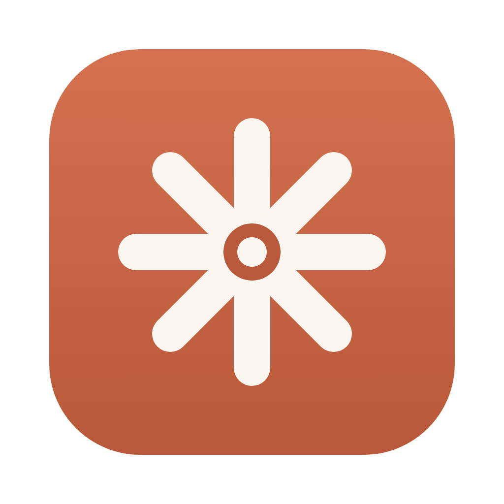
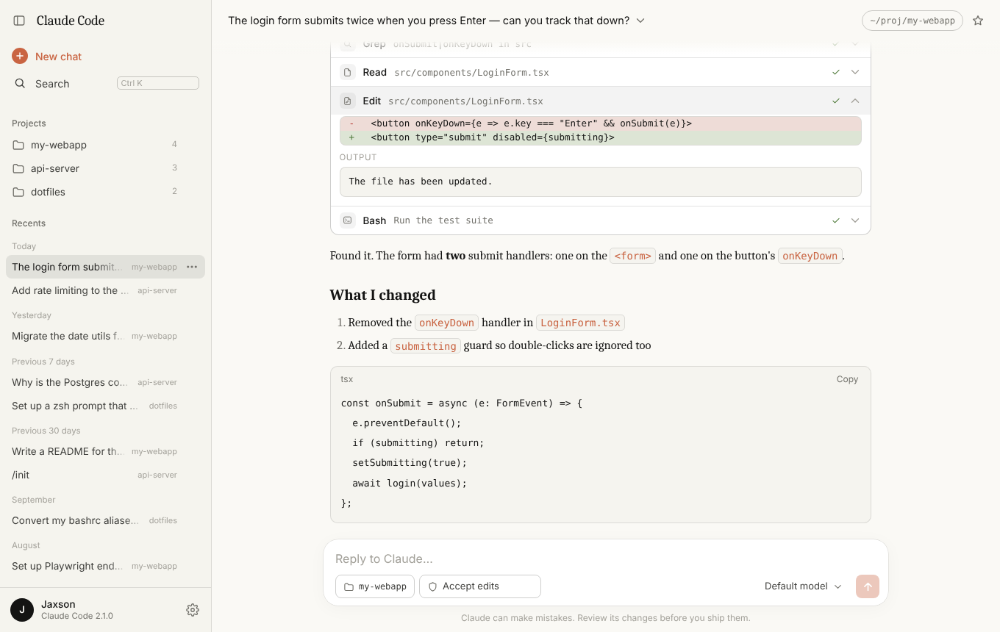
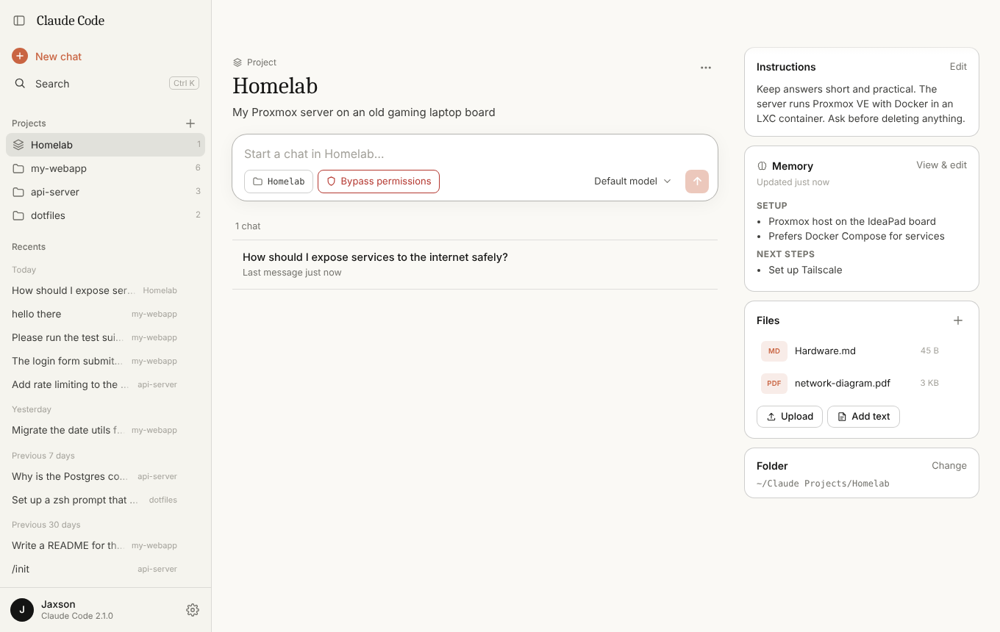
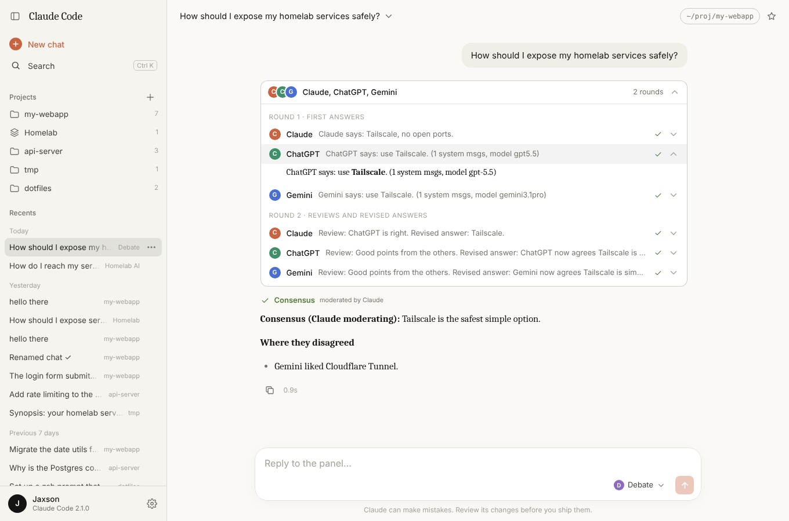
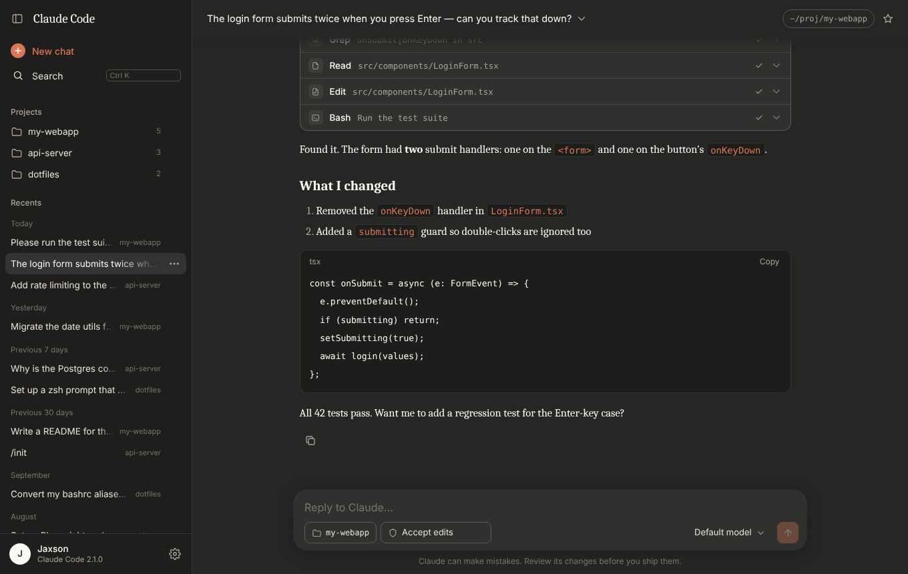
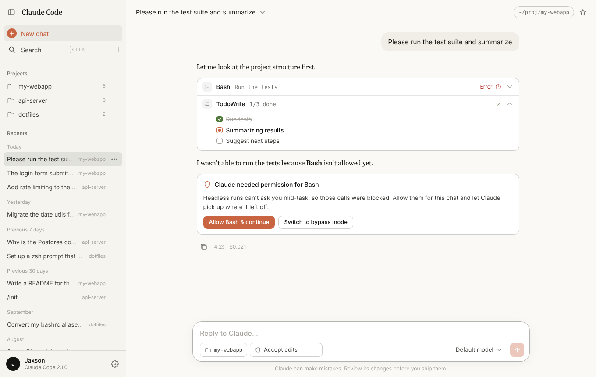

<div align="center">



# Roundtable

**One place for [Claude Code](https://docs.claude.com/en/docs/claude-code/overview) and your other AIs, in a clean claude.ai-style app.**
All your Claude Code sessions in a sidebar, claude.ai-style Projects with shared memory, sync between your computers, and chats or debates with ChatGPT, Gemini and your own Open WebUI model.

[**Download**](../../releases/latest) · [Features](#features) · [Build from source](#build-from-source) · [How it works](#how-it-works)



</div>

> [!NOTE]
> Roundtable was previously called *Claude Code UI*; updating keeps all your chats and settings.
>
> This is an unofficial community project. It isn't made by or affiliated with Anthropic. It's a front end for the official Claude Code CLI, which you install and sign in to separately.

## Features

- **Sync between computers** — sign in with GitHub on each computer and your chats, projects and memory stay the same everywhere, stored in a private repository in your own account. Start a chat on your desktop and continue it on your laptop.
- **Other AI models** — chat with your own **Open WebUI** model (e.g. on a home server, reachable from anywhere over Tailscale), **ChatGPT**, **Gemini** or **DeepSeek**, right next to your Claude Code chats.
- **Debate mode** (optional, off by default) — ask Claude, ChatGPT, Gemini and DeepSeek together. They answer separately, review each other's answers, and a moderator writes the consensus, noting anything they still disagree on.
- **Projects, like on claude.ai** — give a project instructions, reference files and a working folder, and every chat in it shares them. Claude keeps a **shared project memory** (decisions, preferences, key facts) up to date after each chat, and can search the full text of the project's earlier chats when it needs more detail. Every folder you've used Claude Code in shows up as a project automatically.
- **Your whole history, organized** — reads the transcripts Claude Code already saves in `~/.claude/projects`, so chats you started in the terminal show up too. Grouped into Today / Yesterday / Previous 7 days, with a **Projects** list of every folder you've used, plus **Starred** chats.
- **Search** across chat titles and the full text of every message (`Ctrl/⌘+K`).
- **Live streaming** replies with readable tool cards: shell commands with output, file edits as red/green diffs, to-do lists, sub-agents, web fetches.
- **Permissions without the guesswork** — pick *Ask first*, *Accept edits*, *Plan mode* or *Bypass*. If Claude gets blocked on a tool, one click allows it and continues.
- **Pictures and files** — drag and drop anywhere in the window, paste with Ctrl+V (screenshots too), or use the paperclip. Claude Code opens them itself (images, PDFs, code); other models get images directly and text files inline.
- **Several windows at once** — File → New Window (Ctrl+Shift+N), or Ctrl-click / middle-click a chat. Each window works on its own chat and they all run at the same time.
- **Automatic chat titles** — after the first reply, Claude names the chat in a few words, like the Claude apps. Your own renames always win; turn it off in Settings.
- **Type `/` for skills and commands** — like in the terminal and IDE: your skills, custom commands, plugin skills, and the built-ins that work here (`/model`, `/config`, `/mcp`…), with descriptions. Arrow keys and Enter or Tab to pick; Tab completes the first match even with the menu closed.
- **Model picker** (Opus / Sonnet / Haiku), **folder picker** for new chats, and a **stop** button (or `Esc`).
- Keeps working in the background — switch chats while Claude runs; a spinner marks busy chats, and you re-attach to the live output when you come back.
- Rename, star and delete chats. Deleted transcripts go to `~/.roundtable/trash`, never erased.
- Light, dark and system themes, collapsible sidebar, and a phone-sized layout.
- Works with `claude --resume`: every chat has a **Copy resume command** to continue it in the terminal.





<table>
<tr>
<td></td>
<td></td>
</tr>
<tr>
<td align="center"><sub>Dark theme</sub></td>
<td align="center"><sub>Allowing a blocked tool and continuing</sub></td>
</tr>
</table>

## Install

1. Install **Claude Code** and sign in once:
   ```bash
   npm install -g @anthropic-ai/claude-code
   claude
   ```
2. Download the installer for your system from the [**latest release**](../../releases/latest):
   - **Windows:** `Roundtable-…-win-x64.exe`. If Windows shows *"Windows protected your PC"*, click **More info → Run anyway** (the app isn't signed with a paid certificate).
   - **Mac:** the `.dmg` for your chip (`arm64` for Apple Silicon, `x64` for Intel). Drag the app into Applications; the first time, right-click it → **Open** → **Open**.
   - **Linux:** the `.AppImage`. Make it executable (`chmod +x`) and run it.

**Updates install themselves.** The app checks GitHub for new versions; on Windows and Linux it downloads them in the background and a **Restart to update** button appears at the bottom of the sidebar (or the update installs the next time you quit). On Mac the button opens the download page, since only code-signed Mac apps can update themselves. You can also use **File → Check for Updates…**

## Set up sync between computers

In the app: **Settings → Sync**. It walks you through it:

1. **Create a private repository** for your chats (once — e.g. `roundtable-sync`). Keep it private; your chats are stored there.
2. **Create a token for each computer** — a fine-grained GitHub token with access to *only* that repository and *Contents: Read and write*. The app's link pre-fills everything except picking the repository.
3. **Paste it in and sign in.** The first sync merges what's on this computer with what's already there.

After that it syncs every few minutes and after each reply; there's also **Sync now**.

- **Synced:** Claude Code chats, chats with other models, debates, chat names/stars, projects (instructions, memory, files).
- **Not synced:** the files Claude edits in your project folders (use git for code), API keys, and app settings.
- **Continuing on another computer:** if the chat's folder doesn't exist there, the app asks which folder to use.
- **Same chat on two computers at once:** both versions are kept — the other one appears as "(copy from other device)".
- **Deleting** a chat or project on one computer deletes it everywhere (it goes to `~/.roundtable/trash`).

## Add other AI models

**Settings → AI models.** Press **Connect** after entering details to check them and pick a model.

- **Your Open WebUI model:** its address (use the server's Tailscale name or IP so it works away from home, e.g. `http://homelab:3000`) and an API key from Open WebUI's *Settings → Account → API keys*. An admin has to enable API keys first under *Admin settings → Authentication*.
- **ChatGPT:** an API key from [platform.openai.com/api-keys](https://platform.openai.com/api-keys). Billed per use by OpenAI; a ChatGPT Plus subscription doesn't include API access.
- **Gemini:** an API key from [Google AI Studio](https://aistudio.google.com/apikey).
- **DeepSeek:** an API key from [platform.deepseek.com](https://platform.deepseek.com/api_keys). Adding it also adds DeepSeek to debates.

Then pick who answers from the menu in the message box. Keys stay on that computer.

**Debate mode** is off until you turn it on in **Settings → Debate**, where you also choose who takes part, the number of rounds and the moderator. Claude takes part through your Claude Code plan (with tools turned off); ChatGPT and Gemini use their API keys. A 3-model, 2-round debate makes 7 requests per question.

## Build from source

Requires [Node.js](https://nodejs.org) 18 or newer.

```bash
git clone <this repo's URL>
cd roundtable
npm install
npm start          # run the desktop app
npm run dist       # build an installer for your OS into ./dist
npm run web        # or: use it in your browser at http://localhost:3456
npm test           # tests (no Claude Code, GitHub or API keys needed)
```

On Windows you can also double-click `start.bat`, which installs on first run and then opens the app.

### Releasing

Bump `version` in `package.json` and push to `main`. GitHub Actions notices the new version, builds the Windows, Mac and Linux installers, and publishes them as a release tagged `v<version>`. Installed copies of the app update themselves to it.

If you run from source, `git pull` gets the latest code.

## How it works

```
┌──────────── desktop app (Electron) ─────────────┐
│  window  ⇄  local server (server.js, 127.0.0.1)  │
└──────────────────────┬───────────────────────────┘
          reads        │        runs
  ~/.claude/projects ◄─┴─► claude -p --output-format stream-json --resume <id>
```

- **History** comes straight from Claude Code's own transcript files; nothing is copied or synced anywhere.
- **Messages** run `claude` in headless mode in the chat's folder, streaming its events into the window.
- The server only listens on `127.0.0.1` and rejects requests from other hosts or websites, since it can run Claude with tool access.
- Headless mode can't pause to ask for approval mid-task, so tool permissions are chosen up front (or granted afterwards with **Allow & continue**).
- **Projects** live in `~/.roundtable/projects/<id>/` (`files/`, `memory.md`, and `chats/` with plain-text copies of the project's chats). The first message of each project chat carries the instructions, memory, small text files inline, and a list of earlier chats; the folder is shared with Claude via `--add-dir` so it can read the rest. After each reply, a short background Claude call folds anything worth keeping into `memory.md`.
- **Sync** (`sync.js`) talks to the GitHub API directly (no git needed): it compares each file with what both sides looked like at the last sync, pulls the other computers' changes, and pushes this one's as a single commit.
- **Other models** (`ai.js`) use the OpenAI-compatible chat API that OpenAI, Gemini and Open WebUI all offer, with streaming. Those chats are stored in `~/.roundtable/chats/`.
- The server and UI are plain Node and vanilla JavaScript with no dependencies. The desktop app adds Electron and `electron-updater`.

### Options

Environment variables, mostly useful with `npm run web`:

| Variable | Default | Meaning |
|---|---|---|
| `PORT` | `3456` (web) · `3457` (app) | Port to listen on; tries the next one if taken |
| `CLAUDE_BIN` | `claude` | Path to the Claude Code executable if it isn't on your PATH |
| `CLAUDE_CONFIG_DIR` | `~/.claude` | Where Claude Code keeps its data |
| `DEFAULT_CWD` | home / launch folder | Starting folder for new chats |
| `NO_OPEN` | — | Set to `1` so `npm run web` doesn't open a browser |

### Keyboard shortcuts

| Keys | Action |
|---|---|
| `Enter` / `Shift+Enter` | Send / new line |
| `Ctrl/⌘ + K` | Search chats |
| `Ctrl/⌘ + Shift + O` | New chat |
| `Ctrl/⌘ + B` | Toggle sidebar |
| `Ctrl/⌘ + ,` | Settings (desktop app) |
| `Esc` | Stop Claude |

## Project layout

```
server.js            local API, projects, runs the claude CLI
commands.js          the / menu: finds skills, commands and plugins
ai.js                Open WebUI / ChatGPT / Gemini chats and debate mode
sync.js              sync between computers through a private GitHub repo
electron/main.js     desktop window, menu, auto-updates, PATH fix-up
public/              the UI (index.html, app.js, style.css, md.js)
scripts/             tests (with fake GitHub, AI APIs and claude CLI)
build/icon.png       app icon
.github/workflows/   CI and installer builds
```

## License

[MIT](LICENSE)
